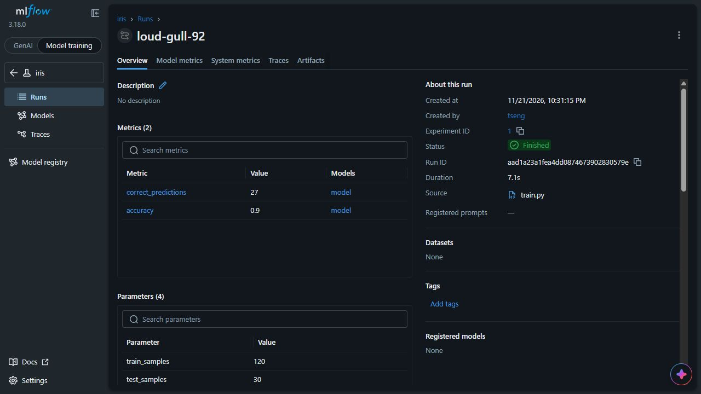
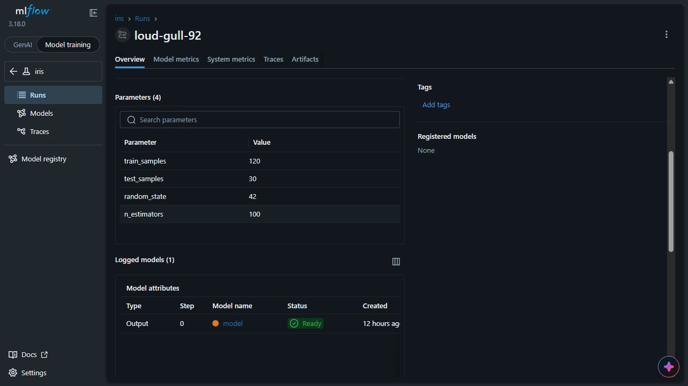
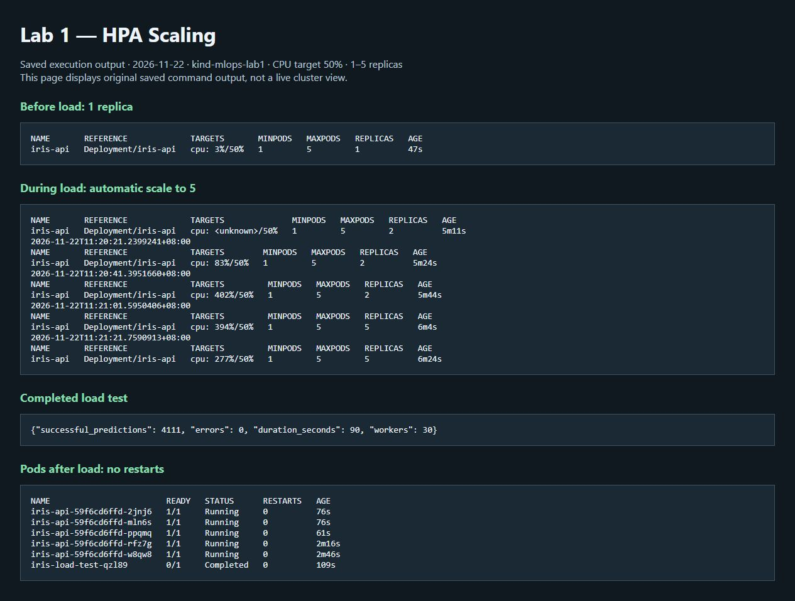

# MLOps Lab 1 — Iris Model Service on Kubernetes

依 Week 1 講義第 49–52 頁實作：scikit-learn 模型訓練、MLflow 追蹤、FastAPI 預測服務、Docker、Kubernetes 與 HPA。

## 執行結果

- 資料：Iris 150 筆，120 筆訓練、30 筆測試，固定 random_state=42 並依品種分層抽樣。
- 模型：RandomForestClassifier，n_estimators=100。
- 準確率：0.90（30 筆答對 27 筆）。
- MLflow Run：aad1a23a1fea4dd0874673902830579e，狀態 Finished。
- HPA：CPU 目標 50%，最少 1、最多 5 個副本。初始 1 個副本；第一輪增至 2，修正健康檢查後的第二輪由 2 增至 5，5 個副本均就緒且未重啟。
- 最終負載測試：30 個工作執行緒、90 秒，4,111 次成功預測、0 次錯誤。

## 執行截圖

### MLflow Run





### HPA Scaling

以下是瀏覽器顯示已保存之原始執行紀錄的截圖，非即時叢集畫面；對應原始文字檔在 evidence/，時間是 Asia/Taipei。



## 檔案

| 路徑 | 用途 |
|---|---|
| src/train.py | 模型訓練、MLflow 紀錄、輸出測試表 |
| src/app.py | POST /predict、GET /healthz |
| Dockerfile、requirements-api.txt | 預測服務容器與依賴 |
| requirements.txt | 訓練與本機開發依賴 |
| k8s/deployment.yaml | Deployment、ClusterIP Service |
| k8s/hpa.yaml | autoscaling/v2 HPA |
| k8s/metrics-server.yaml | metrics-server v0.9.1，供本機 kind 使用 |
| k8s/load-test.yaml | 透過 Service 執行真正預測的負載測試 Job |
| results/test_predictions.csv | 30 筆測試資料、正確答案與預測 |
| screenshots/ | MLflow 與 HPA 執行結果截圖 |
| evidence/ | 原始執行輸出與 HPA 紀錄檢視頁 |

## 1. 訓練與追蹤（PowerShell，專案根目錄）

需要 Python 3.12、Git、Docker Desktop（Linux containers）、kind、kubectl。

```powershell
py -3.12 -m venv .venv
.\.venv\Scripts\python.exe -m pip install -r requirements.txt
.\.venv\Scripts\python.exe src/train.py
.\.venv\Scripts\mlflow.exe ui --backend-store-uri sqlite:///mlflow.db --host 127.0.0.1 --port 5001
```

瀏覽 http://127.0.0.1:5001，選 iris 實驗。模型輸出 model.pkl，實驗資料儲存於本機 SQLite mlflow.db。執行產物不納入 Git，其他人可用程式重現。

## 2. 建置、部署與自動擴充

```powershell
kind create cluster --name mlops-lab1
docker build -t iris-api:v2 .
kind load docker-image iris-api:v2 --name mlops-lab1
kubectl --context kind-mlops-lab1 apply -f k8s/metrics-server.yaml
kubectl --context kind-mlops-lab1 -n kube-system rollout status deployment/metrics-server
kubectl --context kind-mlops-lab1 apply -f k8s/deployment.yaml
kubectl --context kind-mlops-lab1 rollout status deployment/iris-api
kubectl --context kind-mlops-lab1 apply -f k8s/hpa.yaml
kubectl --context kind-mlops-lab1 port-forward svc/iris-api 8082:80
```

另開視窗呼叫：

```powershell
Invoke-RestMethod -Method Post -Uri http://127.0.0.1:8082/predict -ContentType application/json -Body '{"instances":[[5.1,3.5,1.4,0.2]]}'
# predictions: [0]，0 代表 setosa
```

再開視窗產生叢集內負載，讓 Service 分配請求：

```powershell
kubectl --context kind-mlops-lab1 apply -f k8s/load-test.yaml
kubectl --context kind-mlops-lab1 get hpa iris-api -w
# 測試完成後查看結果
kubectl --context kind-mlops-lab1 logs job/iris-load-test
```

Job 同名重跑時，先刪除已完成的測試 Job，再 apply。擴充受 CPU 使用率、節點資源、指標收集延遲影響，不保證每次都擴充到 5。停止負載後，縮容通常需要等待穩定時間。

## 實作調整

- 新版 MLflow 使用 SQLite backend；模型記錄採 cloudpickle，僅載入自己訓練的可信模型。
- /healthz 使用 async，避免健康檢查與同步預測一起排隊。探針 timeout=5 秒，liveness failureThreshold=6。
- metrics-server.yaml 取自官方 https://github.com/kubernetes-sigs/metrics-server/releases/tag/v0.9.1 ，加入僅供本機 kind 的 --kubelet-insecure-tls；正式環境應使用受信任憑證。
- 第一輪 port-forward 負載觸發健康探針逾時，失敗紀錄保留供說明；最終成功結果為 evidence/load-test-v2.txt。
